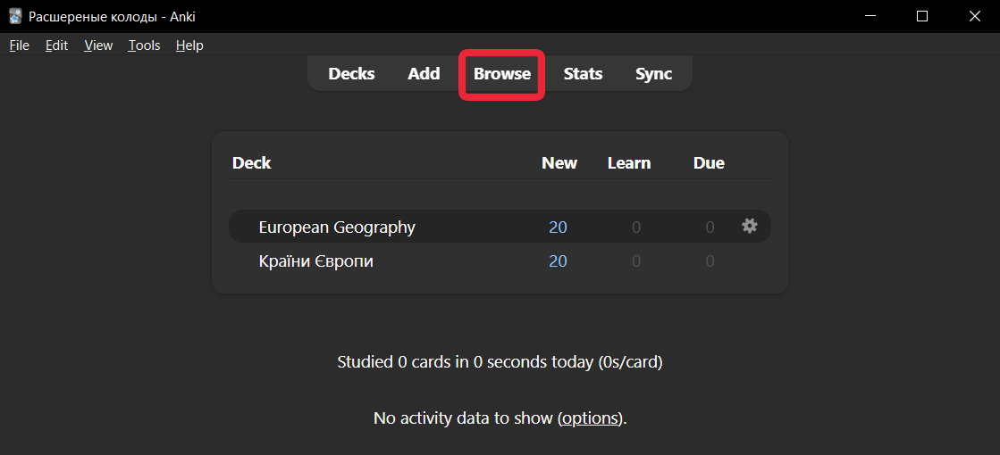
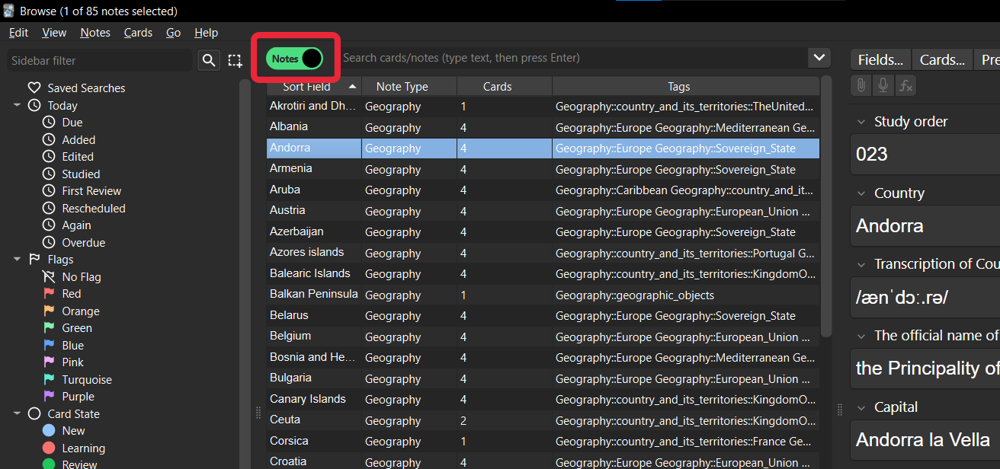
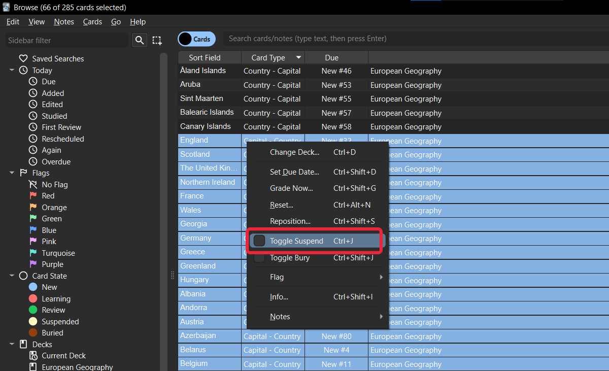

# How to hide ‘Capital – Country’ cards

If you feel that the ‘Capital–Country’ flashcards are overwhelming you at the moment, hide them. I, for example, also started by learning only ‘Country–Capital’, along with the flags and the map.

**Here’s how to temporarily hide the flashcards for the reverse direction:**

### Step 1. Open the deck’s card list

Open Anki, click on the deck you want, and click the ‘Browse’ button at the top of the window.

### Step 2. Open the card list

Click the green button (toggle) between ‘Notes’ and ‘Cards’. We need the cards (blue colour)

### Step 3. Sort the cards

Click on the ‘Card type’ sort button. Scroll down to see all Capital-Country cards as shown in the photo

### Step 4. Hide the cards

Select all cards of this type, right-click, and select ‘Toggle Suspend’

That’s it – cards of this type will no longer appear. You can then restore these cards in the same order. You can restore the Capital-Country cards one by one, or all at once.
