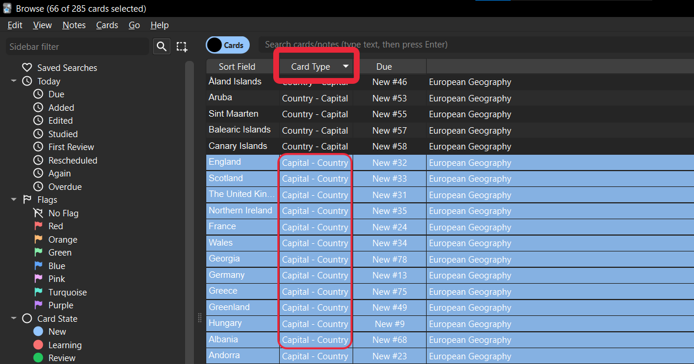

# How to hide ‘Capital – Country’ cards

If you want to start by learning only the ‘Country – Capital’ cards, I recommend temporarily hiding the cards in the opposite direction.

### Step 1. Open the deck’s card list

Open Anki, click on the deck you want, and click the ‘Browser’ button at the top of the window.

### Step 2. Open the card list

Click the green button (toggle) between ‘Records’ and ‘Cards’. We need the cards (blue colour)

### Step 3. Sort the cards

Click on the ‘Card type’ sort button. Scroll down to see all Capital-Country cards as shown in the photo

### Step 4. Hide the cards

Select all cards of this type, right-click, and select ‘Exclude – Include’

That’s it – cards of this type will no longer appear. You can then restore these cards in the same order. You can restore the Capital-Country cards one by one, or all at once.
